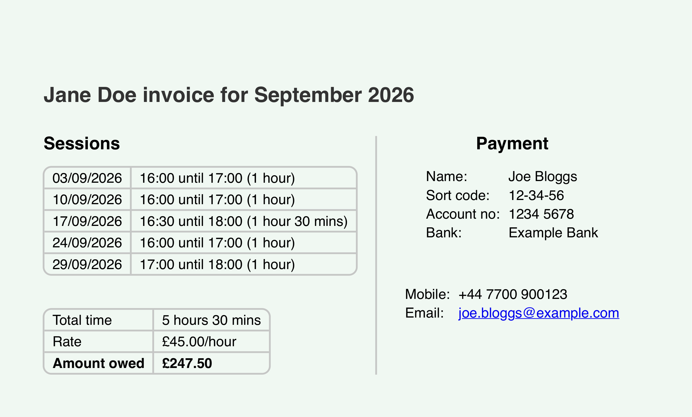

# Invoice generator

[](https://github.com/baiway/invoice-generator/actions/workflows/ci.yml)
[](pyproject.toml)
[](https://github.com/astral-sh/ty)
[](https://github.com/astral-sh/ruff)

Generates PDF invoices for a tutoring business from Google Calendar events. Each lesson is matched to a student in `students.json`, either by the email address of someone invited to the event or, when no one else is invited, by the event's title (e.g. "Tutoring Jane"). Private clients get an invoice each; agencies gets a combined invoice with a page per student.



## Quick start

You need [`uv`](https://docs.astral.sh/uv/), which installs Python 3.11 or newer if you don't already have it.

```shell
git clone https://github.com/baiway/invoice-generator.git
cd invoice-generator
uv sync
```

Then follow the [setup guide](docs/SETUP.md) to connect Google Calendar and add your students, bank details and contact details.

## Usage

Generate invoices for the last full month:
```shell
uv run generate-invoices
```

Some other options:
```shell
# Generate for specific students only
uv run generate-invoices --only "Jane Doe" "John Smith"

# Custom date range
uv run generate-invoices --from 2026-09-01 --to 2026-09-30

# All options
uv run generate-invoices --help
```

### Lesson reports

For students with `reports` set in `students.json`, the generator can also draft a report of what each lesson covered, from the lesson's files in Google Drive:
```shell
uv run generate-invoices --reports
```

Lessons are summarised by Apple's on-device model, so students' work never leaves your Mac: nothing is sent to an AI service. This needs macOS 27 or later, on a Mac with Apple Intelligence.

The invoices are written first, so you can send them while the reports are drafted. Edit the reports, then turn them into PDFs styled like the invoices:
```shell
uv run render-reports
```

See [Lesson reports](docs/SETUP.md#5-lesson-reports-optional) for setting up the folders and the model.

### Output

Invoices are saved as PDFs in the `invoices/` directory:
- Private clients: `jane-doe-invoice.pdf`
- Agency clients: combined into `agency-name-invoice.pdf`

Lesson reports are saved in `reports/` as [Typst](https://typst.app) files to edit, e.g. `jane-doe-report.typ`, and `render-reports` saves each one's PDF beside it.

A detailed log of each run is saved in `logs/`.

## Documentation

- [Setup](docs/SETUP.md): Google Calendar API credentials, the files in `data/`, naming calendar events, and troubleshooting
- [Development](docs/DEVELOPMENT.md): how it works, running the tests, linting and type checking
