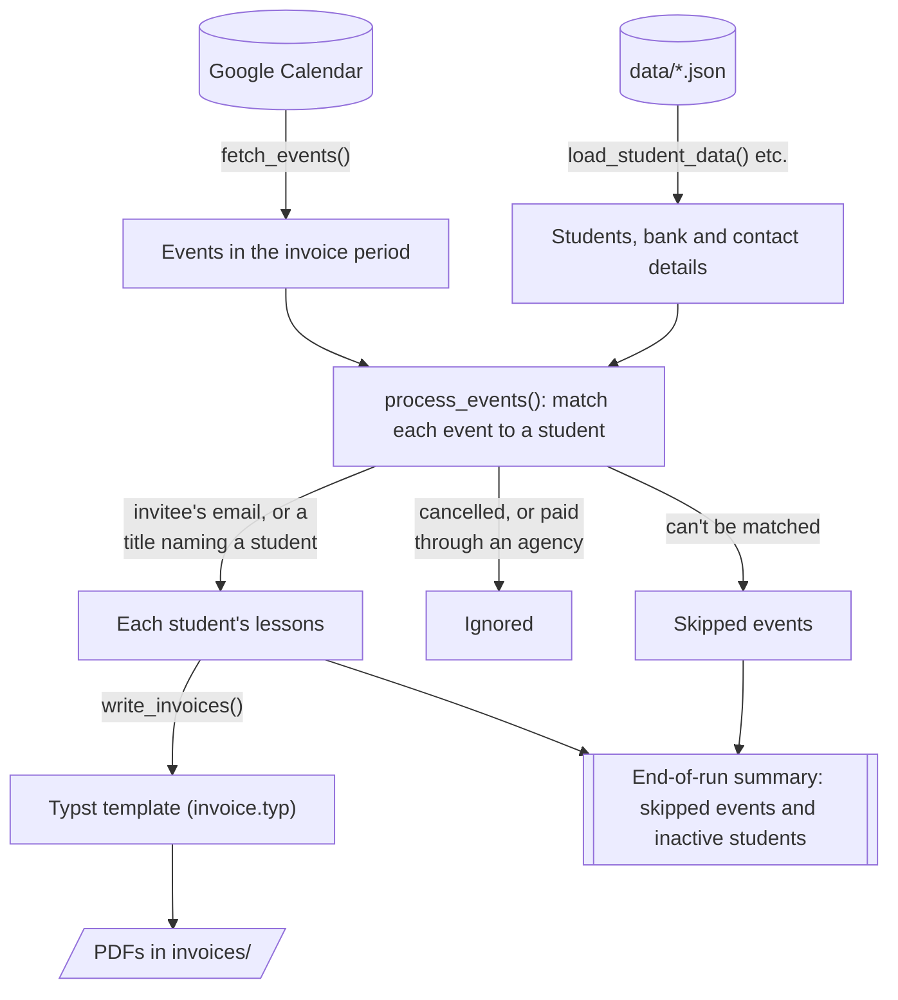

# Development

## How it works



A run of `generate-invoices` ([`cli.py`](../src/invoice_generator/cli.py)) goes through these stages:

1. **Load the configuration.** [`data_loader.py`](../src/invoice_generator/data_loader.py) reads the JSON files in `data/` and validates them against the Pydantic models in [`models.py`](../src/invoice_generator/models.py), which also normalise sort codes, account numbers and phone numbers.
2. **Fetch events.** [`google_auth.py`](../src/invoice_generator/google_auth.py) signs in to Google with read-only access, and [`calendar_api.py`](../src/invoice_generator/calendar_api.py) fetches every event in the invoice period, a page of results at a time.
3. **Match events to students.** [`event_processing.py`](../src/invoice_generator/event_processing.py) drops cancelled events, then matches the rest by attendee email or, for events with no one else invited, by title. The rules are described in [Naming calendar events](SETUP.md#3-naming-calendar-events). Events that look like lessons but can't be matched are kept, with the reason, to report at the end.
4. **Render invoices.** [`invoice_generator.py`](../src/invoice_generator/invoice_generator.py) groups lessons into one PDF per private client and one per agency, and formats everything for display (dates, times, durations and amounts, using [`formatting.py`](../src/invoice_generator/formatting.py)). The result is passed as JSON to the [Typst](https://typst.app) template [`invoice.typ`](../src/invoice_generator/templates/invoice.typ), which only does layout. Because names arrive as data, characters in them can never be read as Typst markup.
5. **Report.** The CLI prints where the invoices and log were saved, then the skipped events grouped by reason, then any students with no lessons in the period.

## Checks

`uv sync` installs the development tools along with the project.

```shell
uv run pytest      # tests; add `--cov` for a coverage report
uv run ruff check  # lint
uv run ty check    # type check
```

- **Tests** never touch the network: the Google API is mocked. Invoices are rendered with the real Typst template and read back with `pypdf`, so the tests check the text of the PDFs rather than how they were produced. Coverage is 100%. The tests import the installed package rather than `src/`, so they exercise what users get.
- **Ruff** is used for linting only, with no formatter. Every function in `src/` must have type hints (ruff's `ANN` rules).
- **ty** checks `src/` and `tests/`, and treats warnings as errors.

## Continuous integration

[`.github/workflows/ci.yml`](../.github/workflows/ci.yml) runs all three checks on every push to `main` and every pull request. It runs them on Python 3.11, the oldest supported version, and on the newest release. Dependencies are installed with `uv sync --locked --no-build`, which fails if `uv.lock` is out of date with `pyproject.toml`, or if a dependency has no prebuilt wheel.

## Project structure

```
invoice-generator/
├── pyproject.toml            # Project configuration
├── uv.lock                   # Exact versions of every dependency
├── LICENSE
├── .github/workflows/ci.yml  # Lint, type check and tests on 3.11 and 3.14
├── docs/                     # Setup and development guides
├── src/
│   └── invoice_generator/    # The package itself
│       ├── cli.py                # Command line interface and entry point
│       ├── google_auth.py        # Signing in to Google
│       ├── calendar_api.py       # Google Calendar API integration
│       ├── drive_api.py          # Google Drive API integration (lesson folders)
│       ├── lesson_files.py       # Preparing lesson files to be summarised
│       ├── summariser.py         # Summarising lessons with Apple's on-device model
│       ├── event_processing.py   # Matching events to students
│       ├── invoice_generator.py  # PDF generation with Typst
│       ├── data_loader.py        # JSON loading with Pydantic validation
│       ├── models.py             # Pydantic models with validators and properties
│       ├── constants.py          # Configuration constants
│       ├── logging_config.py     # Logging setup (file + console handlers)
│       ├── utils.py              # Date utilities
│       ├── formatting.py         # Display formatting (dates, times, currency)
│       ├── py.typed              # PEP 561 marker: the package ships types
│       ├── prompts/
│       │   ├── page-notes.md     # Prompt for noting what each page shows
│       │   └── lesson-topics.md  # Prompt for a lesson's topics, from the notes
│       └── templates/
│           ├── style.typ         # Page and text styling shared by every PDF
│           └── invoice.typ       # Invoice layout, shipped with the package
├── tests/                    # Test suite, one `test_<module>.py` per module
├── data/                     # Your configuration (git-ignored; see SETUP.md)
├── invoices/                 # Generated PDFs (git-ignored)
└── logs/                     # A detailed log of each run (git-ignored)
```
